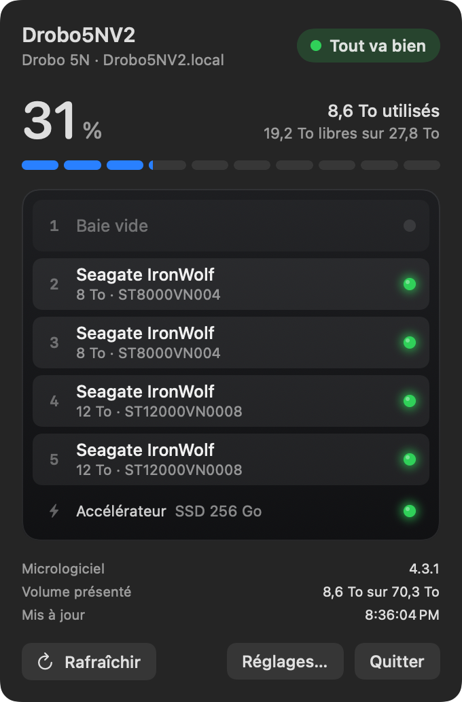
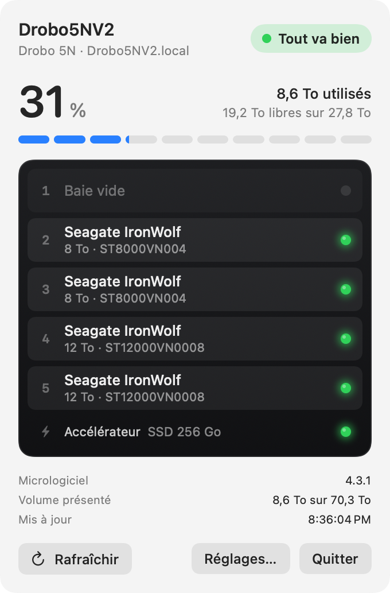

# drobo5n-manager

*[English version](README.md)*

Un remplaçant du Drobo Dashboard, pour ceux qui font encore tourner un NAS
**Drobo 5N2** (ou 5N). Drobo a cessé ses activités et son Dashboard ne fonctionne
plus sur les versions récentes de macOS. Ce projet lit l'appareil directement.

<p>
  
  
</p>

Il contient deux outils :

- **DroboMenuBar** (`mac-app/`) : une petite app pour la barre de menus de macOS.
  C'est l'outil principal.
- **drobo5n** (`drobo5n/`) : un outil Python en ligne de commande, avec une page
  web locale, qui lit les mêmes informations par SSH.

Testé sur un seul appareil : un Drobo 5N2, micrologiciel 4.3.1, depuis macOS 27.
D'autres Drobo réseau fonctionnent peut-être ; les retours sont bienvenus.

## Ce que l'app affiche

- Une pastille de couleur et « DR » dans la barre de menus : verte, jaune, rouge,
  ou grise quand le Drobo est injoignable.
- La **capacité** sur dix voyants, comme la rangée du bas de l'appareil (un
  voyant par tranche de 10 %).
- La **façade** : une rangée par baie, avec le disque, sa taille et son voyant.
- La baie mSATA de l'**accélérateur**.
- Une **notification** quand un voyant change, qu'un disque compte des erreurs,
  que l'état général quitte « normal », ou que le Drobo ne répond plus pendant
  deux minutes.

Elle n'affiche **pas** les températures : le 5N2 ne les publie pas (voir
[Comment ça marche](#comment-ça-marche)).

## Installer l'app

Il faut macOS 13 ou plus récent et les outils en ligne de commande de Xcode
(`xcode-select --install`). Aucun compte développeur Apple n'est nécessaire.

```bash
git clone https://github.com/JFRIOUXX/drobo5n-manager.git
```

```bash
cd drobo5n-manager/mac-app && ./install.sh
```

Le script compile l'app, l'installe dans `~/Applications` et enregistre un
LaunchAgent pour qu'elle démarre à l'ouverture de session. Ensuite :

1. Clique sur **DR** dans la barre de menus, puis sur **Réglages…**.
2. Entre l'adresse de ton Drobo : son nom Bonjour (par exemple
   `MonDrobo.local`) ou son adresse IP.
3. macOS peut demander l'autorisation d'accéder aux appareils du réseau local
   et d'envoyer des notifications. Autorise les deux.

C'est tout ce qu'il faut pour les baies, la capacité et les alertes. Rien n'est
à installer sur le Drobo.

Pour la retirer : `./install.sh uninstall`.

### Facultatif : la contre-vérification par SSH

Si tu entres aussi le compte `admin` du Drobo et son mot de passe, l'app
contre-vérifie l'état général par SSH et affiche la taille du volume présenté.
Il faut pour cela les DroboApps **OpenSSH** et **sudo** sur le Drobo. Le mot de
passe est rangé dans le Trousseau de macOS.

Plus de détails, dont la façon dont l'app est empaquetée et signée :
[`mac-app/BUILD.md`](mac-app/BUILD.md).

## Comment ça marche

Un Drobo réseau diffuse son état complet sur le **port TCP 5000**, sans
authentification. C'est le document XML que lisait le Drobo Dashboard. Tu peux
le regarder toi-même :

```bash
nc MonDrobo.local 5000
```

Chaque message est un en-tête de 16 octets (`DRINASD\0`, puis la longueur du
XML) suivi d'un document `<ESATMUpdate>` : nom, modèle, micrologiciel,
capacités, état général et, pour chaque baie, le voyant, le compteur d'erreurs,
le modèle du disque, son numéro de série et sa taille.

Deux choses à savoir :

- **Les températures n'y sont pas.** Chaque baie a un champ `<mTemperature>`,
  mais sur le 5N2 il vaut toujours 0.
- **Les codes des voyants.** Les états 3 (vert) et 128 (baie vide) ont été
  observés sur un vrai appareil. 0, 1 et 2 (éteint, rouge, jaune) suivent la
  table du projet drobo-utils et n'ont pas été observés ici. Tout autre code
  s'affiche « état N » en jaune.

Par SSH, l'outil interne `esa` donne le même code d'état général
(`sudo esa dnasStatus` : 5 ou 6 veut dire normal) et les capacités.

Le journal complet de la rétro-ingénierie, impasses comprises, est dans
[`PROGRESS.md`](PROGRESS.md).

## L'outil Python

Il faut Python 3.11 ou plus récent, et SSH activé sur le Drobo (DroboApps
OpenSSH et sudo).

```bash
python3 -m venv .venv && source .venv/bin/activate && pip install -r requirements.txt
```

```bash
cp config.example.toml config.toml
```

Mets l'adresse de ton Drobo dans `config.toml`, puis donne le mot de passe
`admin` par l'environnement plutôt que dans le fichier :

```bash
export DROBO5N_PASSWORD="..."
```

| Commande | Ce qu'elle fait |
|---|---|
| `python -m drobo5n ping` | vérifie que la connexion SSH passe |
| `python -m drobo5n status` | état général, capacité réelle, micrologiciel (`--json` pour du JSON) |
| `python -m drobo5n serve` | petite page web locale sur http://127.0.0.1:8765 |
| `python -m drobo5n recon` | vide l'état brut de l'appareil dans un rapport Markdown |

Tout est en lecture seule. `config.toml` et les rapports `recon-*.md` sont
ignorés par git, parce qu'ils peuvent contenir des adresses et des secrets.

## Sécurité

- Les deux outils ne font que lire. Ils ne changent jamais un réglage du Drobo.
- Certaines sous-commandes de `esa` sont destructrices (`vxreboot`,
  `vxshutdown`, `update`, `vxcmd`). Aucun des deux outils ne les appelle ; ne
  les lance pas par curiosité.
- Le port 5000 est sans authentification par conception de l'appareil. Garde le
  Drobo sur un réseau de confiance et ne l'expose pas à Internet.

## Avertissement

Ce projet est personnel et indépendant. Il n'est ni affilié à Drobo ou à ses
propriétaires, ni approuvé ou soutenu par eux ; « Drobo » est une marque de son
propriétaire respectif.

Le logiciel est fourni « tel quel », sans garantie d'aucune sorte, et tu
l'utilises à tes propres risques. L'auteur ne peut être tenu responsable d'une
perte de données, d'un dommage à un appareil ou de toute autre conséquence de
son utilisation (voir la [licence](LICENSE)).

Il lit des interfaces non documentées d'un produit qui n'est plus fabriqué : ce
qu'il affiche peut être faux ou incomplet. Ne compte pas sur lui comme seul
avertissement d'un disque en panne, et garde des sauvegardes.

## Remerciements et références

- [drobo-utils](https://github.com/petersilva/drobo-utils) et son
  [adaptation à Python 3](https://github.com/n3gwg/drobo-utils), pour les codes
  des voyants.
- [DroboPorts](https://www.droboports.com/), pour les DroboApps OpenSSH et sudo.
- [Citadel](https://github.com/orlandos-nl/Citadel), la bibliothèque SSH en
  Swift qu'utilise l'app.

## Licence

[MIT](LICENSE).
