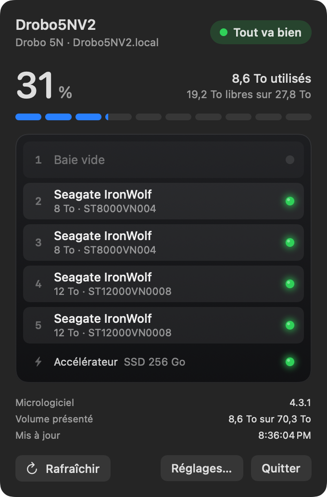
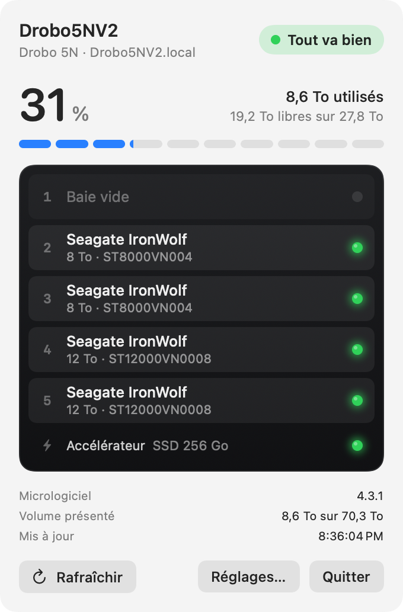

# drobo5n-manager

*[Version française](README.fr.md)*

A replacement for the Drobo Dashboard, for people who still run a **Drobo 5N2**
(or 5N) NAS. Drobo is no longer in business and its Dashboard does not work on
recent versions of macOS. This project reads the device directly.

<p>
  
  
</p>

It contains two tools:

- **DroboMenuBar** (`mac-app/`): a small macOS menu bar app. This is the main one.
- **drobo5n** (`drobo5n/`): a Python command-line tool and local web page that
  read the same information over SSH.

Tested on one device only: a Drobo 5N2, firmware 4.3.1, from macOS 27. Other
network Drobos may work; reports are welcome.

> The app's interface, the code comments and the engineering notes are in French.

## What the app shows

- A colored dot and "DR" in the menu bar: green, yellow, red, or gray when the
  Drobo cannot be reached.
- **Capacity** on ten lights, like the row at the bottom of the device (one
  light per 10 %).
- **The faceplate**: one row per bay, with the disk, its size and its light.
- The mSATA **accelerator** bay.
- A **notification** when a light changes, when a disk reports errors, when the
  overall status leaves "normal", or when the Drobo stops answering for two minutes.

It does **not** show temperatures: the 5N2 does not publish them (see
[How it works](#how-it-works)).

## Install the app

Requirements: macOS 13 or later, and the Xcode Command Line Tools
(`xcode-select --install`). No Apple developer account is needed.

```bash
git clone https://github.com/JFRIOUXX/drobo5n-manager.git
```

```bash
cd drobo5n-manager/mac-app && ./install.sh
```

The script builds the app, installs it in `~/Applications`, and registers a
LaunchAgent so it starts at login. Then:

1. Click **DR** in the menu bar, then **Réglages…** (Settings).
2. Enter the address of your Drobo: its Bonjour name (for example
   `MyDrobo.local`) or its IP address.
3. macOS may ask for permission to reach devices on your local network, and
   to send notifications. Allow both.

That is all you need for the bays, the capacity and the alerts. Nothing has to
be installed on the Drobo.

To remove it: `./install.sh uninstall`.

### Optional: the SSH cross-check

If you also enter the Drobo's `admin` account and password, the app
double-checks the overall status over SSH and shows the size of the presented
volume. This needs the **OpenSSH** and **sudo** DroboApps on the Drobo. The
password is stored in the macOS Keychain.

More details, including how the app is bundled and signed:
[`mac-app/BUILD.md`](mac-app/BUILD.md) (in French).

## How it works

A network Drobo broadcasts its full state on **TCP port 5000**, without
authentication. It is the XML document the Drobo Dashboard used to read. You
can look at it yourself:

```bash
nc MyDrobo.local 5000
```

Each message is a 16-byte header (`DRINASD\0`, then the length of the XML) and
an `<ESATMUpdate>` document with the name, model, firmware, capacities, overall
status and, for each bay, the light, the error count, the disk model, its
serial number and its size.

Two things to know:

- **Temperatures are not there.** Every bay has an `<mTemperature>` field, but
  on the 5N2 it is always 0.
- **Light codes.** A bay status of 3 (green) and 128 (empty bay) were observed
  on a real device. 0, 1 and 2 (off, red, yellow) follow the table of the
  drobo-utils project and were not observed here. Any other code is displayed
  as "état N" in yellow.

Over SSH, the internal `esa` tool gives the same overall status code
(`sudo esa dnasStatus`: 5 or 6 means normal) and the capacities.

The full reverse-engineering journal, dead ends included, is in
[`PROGRESS.md`](PROGRESS.md) (in French).

## The Python tool

Requirements: Python 3.11 or later, and SSH enabled on the Drobo (OpenSSH and
sudo DroboApps).

```bash
python3 -m venv .venv && source .venv/bin/activate && pip install -r requirements.txt
```

```bash
cp config.example.toml config.toml
```

Edit `config.toml` with the address of your Drobo, then give the `admin`
password through the environment rather than the file:

```bash
export DROBO5N_PASSWORD="..."
```

| Command | What it does |
|---|---|
| `python -m drobo5n ping` | checks that the SSH connection works |
| `python -m drobo5n status` | overall status, real capacity, firmware (`--json` for JSON) |
| `python -m drobo5n serve` | small local web page at http://127.0.0.1:8765 |
| `python -m drobo5n recon` | dumps the raw state of the device to a Markdown report |

Everything is read-only. `config.toml` and the `recon-*.md` reports are
git-ignored, because they can contain addresses and secrets.

## Safety

- Both tools only read. They never change a setting on the Drobo.
- Some `esa` subcommands are destructive (`vxreboot`, `vxshutdown`, `update`,
  `vxcmd`). Neither tool calls them; do not run them out of curiosity.
- Port 5000 is unauthenticated by design of the device. Keep the Drobo on a
  network you trust, and do not expose it to the internet.

## Disclaimer

This is an independent, personal project. It is not affiliated with, endorsed
by or supported by Drobo or its owners; "Drobo" is a trademark of its
respective owner.

The software is provided "as is", without warranty of any kind, and you use it
at your own risk. The author cannot be held liable for data loss, damage to a
device or any other consequence of using it (see the [license](LICENSE)).

It reads undocumented interfaces of a discontinued product, so what it displays
may be wrong or incomplete. Do not rely on it as your only warning of a failing
disk, and keep backups.

## Credits and references

- [drobo-utils](https://github.com/petersilva/drobo-utils) and its
  [Python 3 fork](https://github.com/n3gwg/drobo-utils), for the light codes.
- [DroboPorts](https://www.droboports.com/), for the OpenSSH and sudo DroboApps.
- [Citadel](https://github.com/orlandos-nl/Citadel), the Swift SSH library the app uses.

## License

[MIT](LICENSE).
